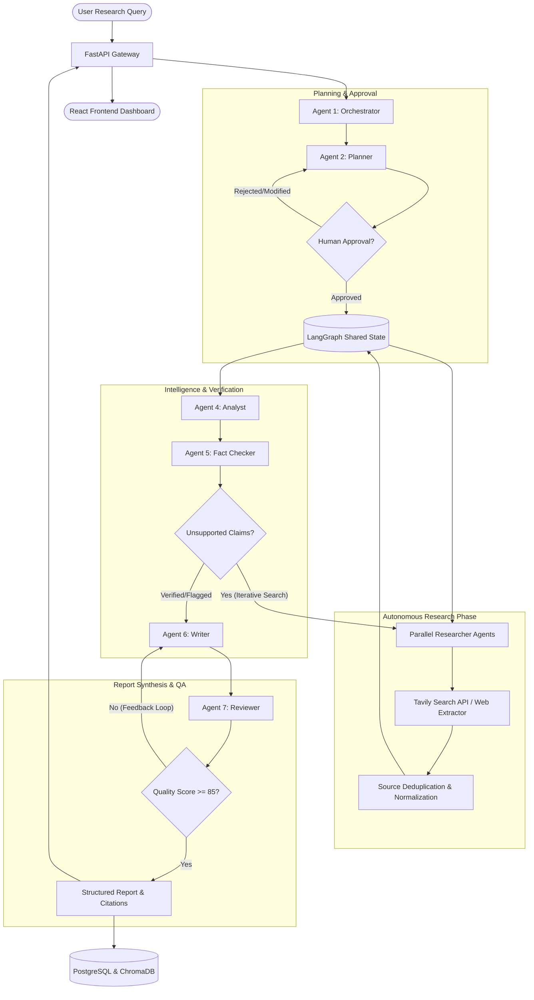

# AgentX System Architecture

> **Tagline:** Multiple Agents. One Intelligent Outcome.

AgentX is an autonomous multi-agent research and intelligence platform designed to eliminate LLM hallucinations, enforce evidence-based research, verify factual claims, and produce publication-grade structured intelligence reports.

---

## 1. High-Level Architectural Flow

---

## 2. Specialized Multi-Agent Roles

| Agent | Core Responsibility | Key Invariants |
| :--- | :--- | :--- |
| **1. Orchestrator** | Coordinates workflow transitions, failure recovery, execution budgets, and lifecycle state. | Never performs raw web research directly. Manages LangGraph state transitions. |
| **2. Planner** | Deconstructs user query into structured, non-overlapping research tasks and subtopics. | Emits validated Pydantic schemas. Identifies domain requirements. |
| **3. Researcher** | Concurrently queries Tavily, scrapes clean text, records source metadata, URL, publication dates. | Strict URL/metadata preservation. Never invents quotes or data. |
| **4. Analyst** | Discovers cross-source patterns, trends, contradictions, and statistical comparisons. | Strict separation between empirical evidence and interpretive analysis. |
| **5. Fact Checker** | Isolates atomic factual claims and rigorously evaluates backing evidence against sources. | Four verdict states: `VERIFIED`, `PARTIALLY_SUPPORTED`, `CONFLICTING_EVIDENCE`, `UNSUPPORTED`. |
| **6. Writer** | Synthesizes an 11-section research report with full inline citation markers. | Professional tone, zero fabricated citations, links directly to retrieved sources. |
| **7. Reviewer** | Performs QA against completeness, logical flow, citation coverage, and evidence strength. | Emits actionable revision feedback. Enforces max revision cycle limit. |

---

## 3. Shared State Management

LangGraph maintains an immutable, traceable `AgentState`:
- **State Schema**: Centralized Pydantic-backed TypedDict.
- **Reducers**: Append-only accumulators for logs, research sources, findings, and verification matrices to prevent race conditions during parallel Researcher executions.
- **Execution Limits**: Guarded with maximum search quotas, maximum LLM invocations, and revision cycle caps.

---

## 4. Memory Architecture

1. **Short-Term Memory**:
   - LangGraph Checkpointers (`MemorySaver` for dev, PostgreSQL checkpointer for production).
   - Preserves active execution graph state, step history, and rewind points.
2. **Long-Term Memory**:
   - **PostgreSQL**: Stores relational models (Users, Research tasks, Execution logs, Sources, Reports).
   - **ChromaDB**: Indexes report chunks and retrieved content embeddings for cross-session semantic search.

